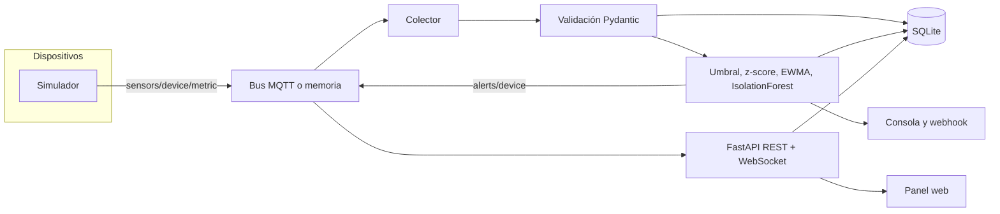

# Sensormon

Sistema de monitorización de sensores IoT sobre MQTT. Un simulador publica telemetría JSON, un colector la valida y la guarda, un motor de anomalías genera alertas y un panel web las muestra en tiempo real. Todo el flujo puede ejecutarse contra un broker Mosquitto o, para demos y pruebas, sobre un bus en memoria dentro de un solo proceso.

## Qué incluye

- Simulador de dispositivos con temperatura, humedad, presión, CO₂ y vibración. Cada serie tiene ruido de medida, deriva, reversión a la media, ciclo lento y averías inyectables (`spike`, `stuck`, `bias`, `dropout`).
- Colector sobre [paho-mqtt](https://pypi.org/project/paho-mqtt/) que valida cada payload con Pydantic y lo persiste.
- Almacén SQLite detrás de una interfaz pequeña (`ReadingStore`), de modo que otro backend puede sustituirlo.
- Detectores enchufables: umbrales, z-score móvil, EWMA y, de forma opcional, Isolation Forest.
- Alertas guardadas en la base de datos y publicadas en `alerts/<device_id>`. Notificadores de consola y webhook.
- API FastAPI (REST + WebSocket) y un panel HTML estático con gráficas por dispositivo.
- CLI Typer: `simulate`, `collect`, `serve`, `dashboard`, `devices` y `alerts`.
- `docker compose` con Mosquitto, colector, simulador y panel.
- Pruebas pytest que no necesitan un broker externo, Ruff y CI en Python 3.11, 3.12 y 3.13.

## Arquitectura



En el modo embebido (`sensormon serve --embedded`) el simulador, el colector y el panel comparten el bus en memoria y el fichero SQLite. No hace falta Mosquitto.

Con Docker, cada pieza es un servicio. El colector es el único escritor de SQLite. El panel lee el mismo volumen y, además, se suscribe al broker para empujar lecturas y alertas por WebSocket.

### Temas y payload

```text
sensors/<device_id>/<metric>
sensors/<device_id>/meta
alerts/<device_id>
```

```json
{
  "device_id": "lab-01",
  "metric": "temperature",
  "value": 22.41,
  "unit": "°C",
  "timestamp": "2026-10-22T15:04:01.120+00:00",
  "quality": "good"
}
```

`quality` vale `good`, `spike` o `fault`. El anuncio de dispositivo viaja en el tema `meta` e incluye `location` y la lista de sensores.

## Requisitos

- Python 3.11 o superior para la ejecución local.
- Docker y Docker Compose para el stack con Mosquitto.
- El extra `ml` (`scikit-learn`) solo si activas Isolation Forest.

## Inicio rápido local

El modo embebido levanta simulador, colector y panel sin broker. A los pocos segundos `lab-01` publica un pico de CO₂ y el panel muestra la alerta.

```bash
python -m venv .venv
source .venv/bin/activate
pip install -e ".[dev,ml]"
sensormon serve --embedded
```

Abre [http://127.0.0.1:8000](http://127.0.0.1:8000).

Para parar el proceso, Ctrl+C. La base queda en `data/sensormon.db`.

```bash
sensormon devices
sensormon alerts --limit 20
```

## Inicio rápido con Docker

```bash
docker compose up --build
```

| Servicio    | Función                                      | Puerto |
|-------------|----------------------------------------------|--------|
| mosquitto   | Broker MQTT anónimo                          | 1883   |
| simulator   | Publica los dispositivos de `config/default.yaml` | —  |
| collector   | Valida, guarda y detecta                     | —      |
| dashboard   | API y panel                                  | 8000   |

El panel queda en [http://127.0.0.1:8000](http://127.0.0.1:8000). Colección y panel comparten el volumen `sensordata`.

También puedes separar los procesos en local si ya tienes un broker en `127.0.0.1:1883`:

```bash
sensormon collect
sensormon simulate
sensormon serve
```

`simulate --transport memory` y `collect --transport memory` hablan con un bus que solo existe dentro de ese proceso. Sirven para probar el arranque. El modo que une las dos puntas sin broker es `serve --embedded`.

## CLI

```text
sensormon simulate [--config ruta] [--transport mqtt|memory] [--duration s]
                   [--mqtt-host host] [--mqtt-port puerto]
                   [--fault dispositivo:metrica:tipo:magnitud[:inicio[:duracion]]]
sensormon collect  [--config ruta] [--transport mqtt|memory] [--duration s] [--db ruta]
sensormon serve    [--embedded] [--host 127.0.0.1] [--port 8000] [--duration s] [--db ruta]
sensormon dashboard   # alias de serve
sensormon devices  [--db ruta] [--json]
sensormon alerts   [--device id] [--severity info|warning|critical] [--limit n] [--json]
```

Ejemplos:

```bash
sensormon simulate --duration 30 --fault lab-01:temperature:spike:18:5:8
sensormon serve --embedded --fault pump-03:vibration:bias:6:2:15
sensormon alerts --device lab-01 --severity critical --json
sensormon --log-level DEBUG serve --embedded --duration 20
```

La avería `spike` suma `magnitud` a la lectura, `bias` desplaza la serie, `stuck` la deja fija en `magnitud` y `dropout` deja de publicarla. `metrica` puede ser `*` para afectar a todos los sensores del dispositivo. Los tiempos van en segundos desde el arranque del simulador.

## Configuración

El fichero por defecto es `config/default.yaml`. Se busca así:

1. `--config` / `-c`
2. La variable `SENSOR_CONFIG`
3. `config/default.yaml` en el directorio de trabajo

Las variables de entorno pisan al YAML. El prefijo es `SENSOR_` y los niveles se separan con `__`.

| Variable | Efecto |
|----------|--------|
| `SENSOR_CONFIG` | Ruta del YAML |
| `SENSOR_MQTT__HOST` | Host del broker |
| `SENSOR_MQTT__PORT` | Puerto del broker |
| `SENSOR_MQTT__USERNAME` | Usuario |
| `SENSOR_MQTT__PASSWORD` | Contraseña |
| `SENSOR_STORAGE__PATH` | Fichero SQLite |
| `SENSOR_API__HOST` | Interfaz del panel |
| `SENSOR_API__PORT` | Puerto HTTP |
| `SENSOR_SIMULATOR__INTERVAL_SECONDS` | Periodo de muestreo |
| `SENSOR_DETECTION__ISOLATION_FOREST__ENABLED` | Activa Isolation Forest |

Bloques principales del YAML:

- `mqtt`: broker, cliente y raíz de tema (`sensors`).
- `storage.path`: SQLite. El directorio se crea si no existe.
- `simulator`: intervalo, semilla, dispositivos y averías programadas.
- `detection`: silencio entre alertas repetidas, umbrales y parámetros de z-score, EWMA e Isolation Forest.
- `notifiers`: `console` y `webhook` (`url`, `timeout_seconds`, `enabled`).
- `api`: host y puerto del panel.

Los umbrales distinguen aviso y nivel crítico. Por ejemplo, un CO₂ por encima de `max` es `warning` y por encima de `critical_max` es `critical`. Los detectores estadísticos marcan `critical` cuando el score supera 1,5 veces su umbral. `detection.cooldown_seconds` evita repetir la misma alerta de un detector, dispositivo y magnitud.

Para activar Isolation Forest:

```yaml
detection:
  isolation_forest:
    enabled: true
```

e instala el extra:

```bash
pip install -e ".[ml]"
```

El webhook recibe el JSON de la alerta mediante POST. Un fallo HTTP no detiene el colector.

## Cómo añadir un sensor

1. Añade el identificador al enum `Metric` en `src/sensormon/models.py`.
2. Registra etiqueta, unidad, color y descripción en `CATALOG` (`src/sensormon/catalog.py`). El panel los pide a `GET /api/catalog`.
3. Declara el sensor bajo `simulator.devices[].sensors` en el YAML. Las claves válidas son los valores de `Metric`. Ajusta `baseline`, `noise`, `drift`, `reversion`, `unit`, `diurnal_amplitude`, `cycle_period_seconds`, `min_value` y `max_value`.
4. Opcional: añade una regla en `detection.thresholds`.
5. Publica en `sensors/<device_id>/<metric>` con el esquema `Reading`. El colector rechaza un payload cuyo `device_id` o `metric` no coincida con el tema.

`min_value` y `max_value` solo recortan lecturas sanas. Una avería `spike` puede salirse de ese rango a propósito para que los detectores la vean.

## Cómo añadir un detector

Un detector expone `name: str` y `evaluate(reading) -> Alert | None`. La lectura se puntúa con el estado anterior; el punto nuevo entra en la ventana después, para no diluir el salto que se quiere ver.

1. Crea la clase en `src/sensormon/detection/`. `make_alert()` en `detection/base.py` rellena el modelo `Alert`.
2. Añade su bloque de configuración en `DetectionConfig` (`src/sensormon/config.py`) y, si aplica, en `config/default.yaml`.
3. Instánciala desde `build_detectors()` en `src/sensormon/factory.py`.
4. Cubre el caso normal y el caso anómalo en `tests/test_detection.py`.

`DetectionEngine` aplica el silencio configurado por `(dispositivo, magnitud, detector)` y devuelve la lista que el colector guarda, publica en `alerts/<device_id>` y entrega a los notificadores.

Un notificador nuevo implementa `notify(alert) -> None`, se añade al literal `NotifierConfig.type` y se construye en `build_notifiers()`.

## Pruebas

```bash
ruff check src tests
ruff format --check src tests
pytest --cov=sensormon --cov-report=term-missing
```

La suite usa el bus en memoria y SQLite temporal. No arranca Mosquitto. El flujo embebido se prueba levantando el API en un puerto local, inyectando un pico y comprobando lecturas y alertas por HTTP.

La integración continua está en `.github/workflows/ci.yml` y repite Ruff y pytest en Python 3.11, 3.12 y 3.13.

## Licencia

MIT. Consulta `LICENSE`.
